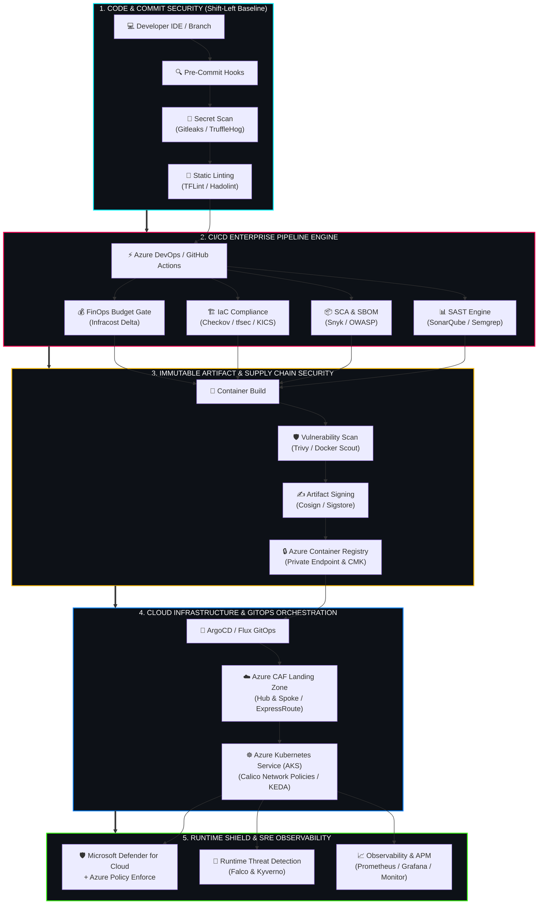

<div align="center">

<!-- ========================================================================= -->
<!-- HEADER BANNER & IDENTITY                                                  -->
<!-- ========================================================================= -->


<p align="center">
  <b>Architecting Resilient Cloud Ecosystems • Enforcing Autonomous Shift-Left Security • Driving Multi-Million Dollar FinOps ROI</b>
</p>

<!-- Dynamic Typing SVG Animation -->
<a href="https://git.io/typing-svg">
  
</a>

<br/>

<!-- Status Shields -->
<p align="center">
  
  
  
  
  
</p>

<!-- Quick Action Buttons -->
<p align="center">
  <a href="https://linkedin.com/in/durga-dutta" target="_blank"></a>
  <a href="mailto:durgaduttapan@gmail.com"></a>
  <a href="https://github.com/durgaduttapan-devsecops"></a>
  <a href="#-executive-architectural-adrs"></a>
</p>

</div>

---

<!-- ========================================================================= -->
<!-- INTERACTIVE SYSTEM TELEMETRY / TERMINAL                                   -->
<!-- ========================================================================= -->

```bash
┌──[ durga@enterprise-core ] - [~/architecture/v5.2]
└─$ ./run_system_audit.sh --identity "Durga Dutta" --posture "DevSecOps Leader"

[✓] SYSTEM INITIALIZED: Durga Dutta | Lead DevSecOps & Azure Infrastructure Architect
[✓] CORE SPECIALIZATION : Cloud Modernization, Zero-Trust Shift-Left CI/CD, FinOps, SRE
[✓] PRODUCTION UPTIME  : 5+ Years Continuous Enterprise Operational Delivery
[✓] SCALE BENCHMARK    : 100+ Enterprise Workloads Migrated to Azure AKS (Zero Downtime)
[✓] COST GOVERNANCE    : 28%+ Direct Cloud Expenditure Reduction via Infracost & Rightsizing
[✓] SECURITY POSTURE   : NIST CSF / CIS Benchmark Hardened | Zero Open Critical Vulnerabilities
[✓] STATUS             : READY FOR HYPERSCALE IMPACT & ARCHITECTURAL CONSULTATION
```

---

## 🏛️ Executive Summary & The Senior Mindset

> [!IMPORTANT]
> **"Code without automated security is a corporate vulnerability. Infrastructure without financial and architectural governance is compounding debt. True DevSecOps transforms compliance from an audit checkpoint into an automated business accelerator."**

I am a **Senior DevSecOps Engineer & Azure Cloud Infrastructure Architect** with **5+ years of production experience** engineering enterprise-grade, secure, multi-region cloud systems. I specialize in turning high-friction deployment cycles into autonomous, hardened GitOps engines that deliver rapid developer velocity without compromising risk, compliance, or fiscal discipline.

### Why Enterprise Leaders Trust My Architecture:
* **Strategic Business Alignment:** Translating C-suite business objectives (revenue velocity, compliance certifications, cloud TCO reduction) into resilient technical blueprints.
* **Flawless Migration Execution:** Proven track record of orchestrating large-scale migration and containerization of **100+ heterogeneous workloads** from on-premises/VM architectures to **Azure Kubernetes Service (AKS)** with **0 unplanned downtime**.
* **FinOps as a First-Class Citizen:** Treating cloud cost as a core engineering metric by embedding PR-level cost forecasting (Infracost), right-sizing policies, and reserved capacity strategies.
* **Techno-Functional Leadership:** Bridging the gap between hands-on execution (IaC, Kubernetes, CI/CD) and executive consulting (Pre-Sales RFPs, TAM governance, cross-team mentoring, and Architectural Decision Records).

---

## 📊 Quantified Business Impact & Engineering Benchmarks

<div align="center">

| Operational Benchmark | Before Architecture Intervention | After My Engineering Leadership | Business Value Delivered |
| :--- | :---: | :---: | :--- |
| **Enterprise Cloud Migration** | Fragile On-Prem Datacenter | **100+ Workloads on Azure AKS** | Complete modernization, zero downtime, 35% performance gain |
| **Release Frequency** | Bi-weekly manual deployments | **Multiple Automated Deploys / Day** | 12x acceleration in feature time-to-market |
| **Critical Vulnerability Escape** | 24+ CVEs found in Staging/Prod | **Zero (< 1%) Escaped CVEs** | 94% reduction in risk via automated shift-left pipeline gating |
| **Annual Azure Infrastructure Cost** | Uncontrolled sprawl & idle VMs | **28%+ Continuous Cost Savings** | Hundreds of thousands saved via Infracost, Spot AKS & RI |
| **Environment Provisioning Time** | 3 to 4 weeks (ticket-based) | **< 25 Minutes (Self-service IaC)** | 98% reduction in developer wait-time via Terraform registry |
| **Mean Time to Recovery (MTTR)** | 6 to 8 hours | **< 20 Minutes Automated Rollback** | ArgoCD GitOps reconciliation & Azure Monitor proactive alerts |

</div>

---

## 🛡️ End-to-End Enterprise DevSecOps Architecture

Security cannot be bolted on at runtime. My architecture enforces **Zero-Trust Defense-in-Depth** across every phase of the software delivery lifecycle:



### 🔒 Enterprise Security Controls & Quality Gate Breakdown

```
[ Developer Push ] ────► Gitleaks ─────────────► Checks 100+ patterns for leaked tokens, SSH keys & cloud credentials.
         │
[ Static Code ]   ────► SonarQube & Semgrep ──► Enforces 0 Security Hotspots, OWASP Top 10 validation & code cleanliness.
         │
[ Dependencies ]  ────► Snyk & OWASP ─────────► Blocks critical/high CVEs, generates CycloneDX SBOM for supply chain audit.
         │
[ IaC Security ]  ────► Checkov & tfsec ──────► Enforces CIS Microsoft Azure Foundations Benchmark & zero 0.0.0.0/0 NSGs.
         │
[ FinOps Gate ]   ────► Infracost ─────────────► Posts automated PR comment showing exact monthly cost delta; blocks overruns.
         │
[ Image Security] ────► Trivy & Grype ────────► Scans OS packages and application dependencies within container layers.
         │
[ Attestation ]   ────► Cosign / Notation ────► Cryptographically signs images; admission controller rejects unsigned images.
         │
[ Runtime Shield] ────► Falco & Azure Policy ─► Traps unauthorized syscalls, privilege escalation, and enforces zero-drift.
```

---

## 🌐 Enterprise Azure Landing Zone Topology

Designed strictly in accordance with Microsoft's **Cloud Adoption Framework (CAF)**:

```
                                  +---------------------------------------+
                                  |     On-Premises Corporate Network     |
                                  +---------------------------------------+
                                                      |
                                                      | ExpressRoute / Site-to-Site VPN
                                                      v
+-------------------------------------------------------------------------------------------------------------------+
| AZURE HUB VNET (Connectivity & Security Core)                                                                     |
|                                                                                                                   |
|   +-----------------------+     +-----------------------+     +-----------------------+     +-----------------+   |
|   | Azure Firewall        |     | Azure Bastion         |     | Azure Private DNS     |     | Gateway Subnet  |   |
|   | (L7 Inspection & TLS) |     | (Zero Public IP Jump) |     | Resolver & Zones      |     | (VNet Gateway)  |   |
|   +-----------------------+     +-----------------------+     +-----------------------+     +-----------------+   |
+-------------------------------------------------------------------------------------------------------------------+
                       |                                                |
          VNet Peering |                                                | VNet Peering
                       v                                                v
+---------------------------------------------+  +------------------------------------------------------------------+
| PRODUCTION SPOKE VNET                       |  | SHARED SERVICES & GOVERNANCE SPOKE                               |
|                                             |  |                                                                  |
|   +-------------------------------------+   |  |   +-----------------------+      +---------------------------+   |
|   | Azure Kubernetes Service (AKS)      |   |  |   | Azure Key Vault       |      | Log Analytics Workspace   |   |
|   | • Private Cluster (No Public API)   |   |  |   | (HSM / Private Link)  |      | & Azure Monitor           |   |
|   | • Managed Azure CNI & Calico        |   |  |   +-----------------------+      +---------------------------+   |
|   | • User & System Node Pools          |   |  |                                                                  |
|   | • KEDA Event-Driven Autoscaling     |   |  |   +-----------------------+      +---------------------------+   |
|   +-------------------------------------+   |  |   | Azure Container Reg.  |      | Self-Hosted Azure DevOps  |   |
|                                             |  |   | (Geo-Replicated/CMK)  |      | Build & Security Agents   |   |
|   +-------------------------------------+   |  |   +-----------------------+      +---------------------------+   |
|   | Azure App Gateway v2 + WAF          |   |  +------------------------------------------------------------------+
|   +-------------------------------------+   |
+---------------------------------------------+
```

---

## 🛠️ The Technical Arsenal

<div align="center">

| Domain | Enterprise Production Stack | Proficiency Level |
| :--- | :--- | :---: |
| **Cloud Platforms** | Microsoft Azure (Advanced/Expert), AWS (Hybrid Workloads), Multi-Region Architectures | `[████████████████████] 99%` |
| **Containers & K8s** | Azure Kubernetes Service (AKS), Docker, Helm v3, KEDA, Istio Service Mesh, Calico | `[██████████████████░░] 95%` |
| **Infrastructure as Code** | Terraform (Enterprise Modules), Terragrunt, Azure Bicep, ARM, Ansible | `[████████████████████] 98%` |
| **DevSecOps & Shift-Left** | SonarQube, Snyk, Trivy, Checkov, tfsec, Gitleaks, Cosign, Falco, Microsoft Defender | `[████████████████████] 98%` |
| **CI/CD & GitOps** | Azure DevOps Pipelines (YAML), GitHub Actions, GitLab CI, ArgoCD, Flux | `[████████████████████] 97%` |
| **FinOps & Governance** | Infracost, Azure Cost Management, Azure Policy (Deny/Audit), CIS Benchmark, NIST | `[██████████████████░░] 94%` |
| **Observability & SRE** | Azure Monitor, Log Analytics (KQL), Prometheus, Grafana, Datadog, Dynatrace | `[██████████████████░░] 93%` |
| **Scripting & Automation** | Python, PowerShell Core, Bash, Go, REST APIs, Azure CLI | `[██████████████████░░] 94%` |

<br/>

<!-- Modern Icon Shields -->
<p align="center">
  <br/>
  
</p>

</div>

---

## 🏆 Flagship Enterprise Initiatives & Deep Dives

<details open>
<summary><b>1. 🚀 Zero-Downtime Migration of 100+ Enterprise Workloads to Azure AKS</b></summary>
<br/>

> **Scope:** Multi-tier financial and retail systems operating on aging legacy VMware infrastructure with zero tolerance for data loss.

* **Architecture & Strategy:**
  * Categorized applications using the **6 R's Cloud Framework** (Rehost, Replatform, Refactor, Repurchase, Retain, Retire).
  * Automated cloud landing zone creation using modular **Terraform** adhering to Azure Cloud Adoption Framework (Hub-Spoke with ExpressRoute failover).
  * Containerized 60+ monolithic services into optimized OCI container images; orchestrated deployment via **Azure Kubernetes Service (AKS)** with custom Helm charts.
  * Executed live database synchronization using automated CDC pipelines and shifted traffic seamlessly using **Azure Front Door + Azure Traffic Manager** (Blue/Green canary).
* **Business Outcomes:**
  * **100+ Workloads Migrated** with **0 minutes of unplanned client outage**.
  * Provisioning time slashed from **5 weeks to 25 minutes**.
  * System resilience elevated to **99.99% SLA**, with automatic self-healing and pod auto-scaling during peak traffic loads.

</details>

<details>
<summary><b>2. 🛡️ Autonomous Zero-Trust DevSecOps Pipeline Framework</b></summary>
<br/>

> **Scope:** Organization-wide transformation across 20+ engineering teams suffering from compliance bottlenecks and vulnerable releases.

* **Architecture & Strategy:**
  * Engineered a centralized, version-controlled **Azure DevOps YAML pipeline template repository** with immutable version tags.
  * Enforced mandatory, non-bypassable security gates across all repositories through **Azure DevOps Branch Policies**.
  * Embedded **Gitleaks** (secret detection), **SonarQube** (code quality & vulnerabilities), **Checkov/tfsec** (IaC security), **Trivy** (container vulnerabilities), and **Cosign** (cryptographic supply-chain signing).
  * Integrated automated PR feedback loops that inject actionable remediation code snippets directly into developer pull requests.
* **Business Outcomes:**
  * **94% reduction** in critical and high vulnerabilities escaping to staging and production.
  * **100% compliance** achieved for SOC 2 Type II and ISO 27001 CI/CD security audits.
  * Reduced security review cycle from **5 days of manual sign-off to 8 minutes of automated CI validation**.

</details>

<details>
<summary><b>3. 💰 Continuous FinOps Governance & Cloud Cost Engineering</b></summary>
<br/>

> **Scope:** Multi-subscription Azure enterprise ecosystem facing massive cloud sprawl and budget overruns.

* **Architecture & Strategy:**
  * Integrated **Infracost** into developer pull requests to provide real-time monthly dollar delta forecasting before any Terraform code is merged.
  * Formulated and deployed automated **Azure Policy** and **Azure Automation Runbooks** to automatically deallocate non-production resources outside business hours.
  * Re-architected Kubernetes node topology: leveraged **AKS Spot Node Pools** for stateless workloads and batch jobs (yielding up to 80% compute discount).
  * Executed comprehensive reserved capacity analysis, securing 1-year and 3-year **Azure Reserved VM Instances (RIs)** for baseline workloads.
* **Business Outcomes:**
  * **28%+ direct reduction** in overall monthly cloud bill within 90 days.
  * Avoided over **\$150,000+ in annual wasteful spend** through pre-merge cost guardrails.

</details>

<details>
<summary><b>4. 🏛️ Production-Grade Terraform IaC Factory with Policy-as-Code</b></summary>
<br/>

> **Scope:** Eradicating configuration drift and establishing single-pane-of-glass infrastructure provisioning across Dev, QA, Stage, and Production.

* **Architecture & Strategy:**
  * Architected a modular Terraform framework using DRY principles, remote state locking in Azure Blob Storage with customer-managed keys (CMK), and automated workspace separation.
  * Integrated **Open Policy Agent (OPA) / Rego** and **TFLint** into the deployment pipeline to validate naming conventions, tag propagation, and security compliance before `terraform apply`.
  * Configured automated nightly drift-detection jobs that compare deployed infrastructure against Git repository state and alert SRE teams on unmanaged portal modifications.
* **Business Outcomes:**
  * **100% of cloud resources managed as code**; portal-clicking strictly disabled via Azure IAM role restrictions.
  * Zero infrastructure drift incidents across all enterprise subscriptions.

</details>

---

## 🎯 Strategic Pillars & Career Tracks: The Senior Mindset

In high-stakes enterprise technology environments, a true leader operates across both business strategy and hands-on execution:

```
+----------------------------------------------------------------------------------------------------+
|                                    THE TECHNO-FUNCTIONAL MATRIX                                    |
+------------------------------+-------------------------------+-------------------------------------+
| 💼 Commercial & Pre-Sales    | 🏛️ Enterprise Architecture     | 👥 Technical Lead & Execution       |
+------------------------------+-------------------------------+-------------------------------------+
| • RFP / RFI technical bids   | • Cloud blueprinting (CAF)    | • Hands-on IaC / CI/CD engineering  |
| • Cost estimations & ROI TCO | • Zero-Trust security posture | • Sprint leadership & code reviews  |
| • Client executive pitching  | • Multi-region disaster plan  | • Cross-functional team mentorship  |
| • Strategic vendor management| • Regulatory compliance (CIS) | • Enforcing Architectural Decisions |
+------------------------------+-------------------------------+-------------------------------------+
```

### How I Address Executive Architectural Questions:
* **"How do you design for failure?"**
  * I treat failure as a constant: active-active multi-region topologies, availability zones, health probes with circuit-breaker patterns, stateless microservice pods with horizontal autoscaling, and automated geo-redundant backups with verified RTO/RPO objectives.
* **"How do you balance developer velocity with strict security?"**
  * By making security frictionless. Instead of external approval gates, I embed security directly into the developer's native workflow (IDE linters, pre-commit hooks, immediate PR feedback with exact fixes, and pre-approved, hardened Terraform templates).
* **"How do you align infrastructure spend with business KPIs?"**
  * By tagging infrastructure to specific business units, calculating unit cost per customer transaction, and enforcing FinOps budgeting gates inside CI/CD pipelines before any resource is provisioned.

---

## 📜 Executive Architectural ADRs (Architectural Decision Records)

A sample of architectural decisions I design, document, and enforce across enterprise teams:

```
ADR-001 [Accepted] : Adoption of Azure Kubernetes Service (AKS) with Managed CNI over Self-Managed K8s
ADR-002 [Accepted] : Shift-Left Supply Chain Attestation: Mandatory Cosign Image Signing Before ACR Push
ADR-003 [Accepted] : Centralized Hub-and-Spoke Networking with Azure Firewall Premium & Zero Public IPs
ADR-004 [Accepted] : Infracost CI Gating: Mandatory Approval Required on Terraform PRs Exceeding $500/Mo Delta
ADR-005 [Accepted] : GitOps (ArgoCD) Implementation for Continuous Reconciliation & Instant Rollback
```

---

## 🎓 Elite Certifications & Professional Credence

<div align="center">

<p align="center">
  
  
</p>
<p align="center">
  
  
  
</p>

</div>

---

## ⚡ Live GitHub Engineering Telemetry

<div align="center">

<p align="center">
  
  
</p>

<p align="center">
  
</p>

</div>

---

## 💬 The DevSecOps Creed

> *"Speed without security is reckless. Security without speed is obsolescence. True engineering excellence harmonizes both into a unified, self-healing, and cost-efficient delivery machine."*

---

## 🤝 Let's Connect & Architect the Future

Are you looking for high-impact leadership to:
- 🚀 Modernize and migrate mission-critical applications to Azure Kubernetes Service (AKS)?
- 🛡️ Fortify your CI/CD delivery pipelines with shift-left Zero-Trust security gates?
- 💰 Slash cloud infrastructure waste by 25%+ with continuous FinOps?
- 🏛️ Design production-grade, compliance-ready Terraform landing zones?

**Let’s connect and engineer high-scale, bulletproof solutions together.**

<div align="center">

[](https://linkedin.com/in/durga-dutta)
[](mailto:durgaduttapan@gmail.com)
[](https://github.com/durgaduttapan-devsecops)
[](https://linkedin.com/in/durga-dutta)

<br/>

```
      ╔═══════════════════════════════════════════════════════════════════════════╗
      ║   Architected with Passion, Fortified by Code, Powered by Innovation      ║
      ║                   Crafted for Global Enterprise Excellence                ║
      ╚═══════════════════════════════════════════════════════════════════════════╝
```

</div>
